# Phân tích và dự đoán điểm review rượu từ thông tin sản phẩm và văn bản

Dự án sử dụng **Wine Reviews 130k**, lấy **phân tích dữ liệu làm trọng tâm**: tìm hiểu giá, xuất xứ, giống nho và nội dung review liên hệ với điểm `points` như thế nào. Mục tiêu bổ trợ là đánh giá khả năng ước lượng điểm bằng **metadata + TF-IDF review → Ridge** đã khóa; không mở rộng thuật toán hoặc tuning theo test.

**Đọc kết quả:** [Hướng dẫn nghiên cứu](docs/RESEARCH_GUIDE.md) → [bảng câu hỏi–bằng chứng](outputs/eda/QUESTION_MAP.md) → [EDA](outputs/eda/REPORT.md) → [thống kê giá–điểm](outputs/analysis/REPORT.md) → [đánh giá mô hình](outputs/model_report/REPORT.md).

Đơn vị quan sát là **một bản ghi review**, không mặc định là một chai rượu duy nhất. Một tên rượu có thể có nhiều review. `points` là đánh giá của người chấm, không phải phép đo chất lượng khách quan.


## Dự án trong một trang

| Dữ liệu | Phân tích | Dự đoán bổ trợ |
|---|---|---|
| **129.971** review gốc | Giá, xuất xứ, giống nho và review | Metadata + TF-IDF → Ridge |
| **119.988** review sau cleaning | EDA chi tiết trên **78.106** dòng train | MAE test **1,209 điểm** |
| **111.593** dòng có giá quan sát | Spearman cấp nhóm title, CI bootstrap | **81,32%** dự đoán test lệch không quá 2 điểm |

**Cách đọc:** theo câu hỏi nghiên cứu → hình và bảng → phát hiện → cách xử lý/hàm ý → giới hạn. Các số dự đoán lấy từ [bảng metric](outputs/model_report/metrics.csv); tỷ lệ trong ngưỡng sai số là thống kê bổ sung sau đánh giá.

## 1. Bối cảnh và câu hỏi nghiên cứu

Người mua thường tham khảo giá, xuất xứ, giống nho và lời đánh giá khi lựa chọn rượu. Tuy nhiên, giá cao không bảo đảm mọi review đều cho điểm cao; dữ liệu cũng có sự khác nhau về nhóm sản phẩm và người chấm. Nhóm dùng phân tích dữ liệu để mô tả những liên hệ này và xây dựng một quy trình dự đoán có thể kiểm tra lại.

**Câu hỏi chính:** Giá, xuất xứ, giống nho và nội dung review có liên hệ như thế nào với điểm đánh giá?

**Câu hỏi bổ trợ:** Mô hình kết hợp hiện có ước lượng điểm tốt đến đâu và còn sai ở những nhóm nào?

Các câu hỏi hỗ trợ:

1. Giá và điểm review có quan hệ như thế nào? Xu hướng giữa các khoảng giá có giống nhau không?
2. Điểm và số lượng review khác nhau như thế nào giữa các quốc gia, vùng và giống nho?
3. Văn bản review có đặc điểm gì về độ dài và từ/cụm từ phổ biến?
4. Mô hình kết hợp còn sai ở những nhóm nào, và kết quả có giới hạn gì khi sử dụng?

Một mô hình kết hợp duy nhất **chưa chứng minh review cải thiện dự đoán bao nhiêu**. Muốn trả lời riêng điều này cần bổ sung mô hình chỉ thông tin sản phẩm để đối chiếu trên cùng bản ghi và split. So sánh A/B/C không phải yêu cầu triển khai hiện tại.

## 2. Nhiệm vụ và đầu ra của dự án

| Công việc | Mục đích | Đầu ra |
|---|---|---|
| Audit | Hiểu schema, missing, duplicate và miền giá trị | Data dictionary, báo cáo audit |
| Cleaning | Xử lý thiếu, không nhất quán, trùng và lỗi giá có lưu dấu | Dữ liệu sạch, cleaning log |
| Chọn mẫu và split | Tách dữ liệu theo nhóm tên rượu | CSV train/validation/test, kiểm tra tái lập |
| EDA | Mô tả giá, điểm, metadata và review | Notebook, bảng CSV, biểu đồ |
| Thống kê khám phá | Spearman giá–điểm ở cấp nhóm title trên train | Hệ số, CI bootstrap, p-value xấp xỉ và giới hạn |
| Preprocessing | Mã hóa sản phẩm và vector hóa review | Bộ xử lý fit trên train |
| Modeling | Học ánh xạ từ đặc trưng kết hợp sang điểm | Pipeline Ridge + preprocessing |
| Đánh giá validation | Đo sai số tổng thể và theo nhóm | MAE, RMSE, R², dự đoán và phân tích phần dư |
| Báo cáo | Kết nối phát hiện với câu hỏi và giới hạn | Báo cáo và phần trình bày có bằng chứng |

Đã triển khai pipeline **metadata + TF-IDF review → Ridge**, chọn alpha bằng CV theo nhóm trên train và báo cáo validation. Đã đánh giá test ngày 13/11/2026 bằng mô hình đã khóa; đã bổ sung thống kê khám phá giá–điểm trên train, không phải kiểm định đăng ký trước. Không dùng embedding; web/API không thuộc đầu ra hiện tại.

## 3. Dữ liệu và vai trò biến

- Nguồn: [Kaggle — Wine Reviews](https://www.kaggle.com/datasets/zynicide/wine-reviews).
- Giấy phép theo tài liệu nguồn đã ghi nhận trong dự án: **CC BY-NC-SA 4.0**; cần tuân thủ điều kiện khi chia sẻ/sử dụng.
- Raw: `data/raw/winemag-data-130k-v2.csv`, **129.971 dòng × 14 cột**.
- Cleaned: `data/processed/wine_cleaned_final.csv`, **119.988 dòng × 19 cột**.
- Sau cleaning có **111.593 dòng có giá quan sát**; **8.395 dòng thiếu giá** vẫn được giữ để audit.
- SHA-256 raw: `52af2643c8ac29f010f0cc629dfbdda1c74aa0f332d11762af9ef3de4e567ac9`.

| Biến | Vai trò trong mô hình | Xử lý |
|---|---|---|
| `points` | Nhãn mục tiêu | Hồi quy điểm review, không đưa vào đầu vào |
| `price` / `log_price` | Giá sản phẩm | Dùng `log1p(price)` với giá quan sát; không dùng đồng thời hai biểu diễn mặc định |
| `country`, `province`, `variety` | Metadata chính; vùng dùng `province` | Nhãn thiếu và one-hot; nhóm hiếm nếu cần, học trên train |
| `vintage_year` | Niên vụ trích từ tiêu đề | Điền năm thiếu và chuẩn hóa bằng thống kê train |
| `description` | Review của người đánh giá rượu | TF-IDF unigram/bigram fit trên train |
| `title` | Chia nhóm và trích niên vụ | Không dùng nguyên văn làm predictor |
| `taster_name`, `taster_twitter_handle` | Audit và phân tích bias | Không làm predictor chính |
| `region_1`, `region_2`, `winery`, `designation` | Dữ liệu bổ trợ | Chưa chọn làm predictor mặc định |
| `price_original`, `price_was_missing`, `price_was_corrected`, `is_non_informative_review` | Theo dõi xử lý dữ liệu | Không làm predictor |

Chi tiết schema raw và cleaned: [Data Dictionary](docs/data_dictionary.md). `description` là lời của người đánh giá trong dataset; không mặc định gọi là review của khách hàng/người dùng.

## 4. Quy trình từ đầu đến cuối

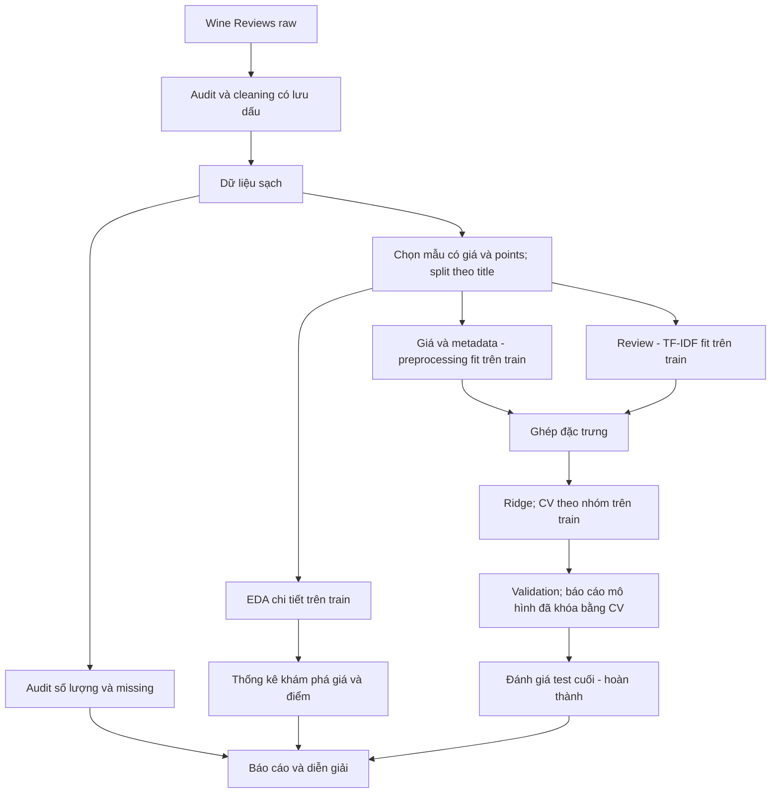

### 4.1. Cleaning hiện có

Pipeline xử lý missing → consistency → duplicate hoàn toàn → outlier/noise → validation. Giữ giá thiếu, không biến giá ước tính thành quan sát. Hai hiệu chỉnh giá được giữ cùng trường audit; đây là quyết định có lưu vết, không coi là bằng chứng độc lập về giá thị trường. Giá cao hợp lệ và điểm 100 vẫn được giữ. Review ngắn chỉ được gắn cờ, không tự động loại.

**Dữ liệu thay đổi qua từng bước như thế nào?**

| Sau bước | Số dòng | Số cột | Giá còn thiếu | Kết quả chính |
|---|---:|---:|---:|---|
| Dữ liệu gốc | 129.971 | 14 | 8.996 | Audit trước xử lý |
| Xử lý thiếu | 129.971 | 14 | 8.996 | Gắn nhãn thiếu cho metadata, giữ giá thiếu |
| Chuẩn hóa | 129.971 | 14 | 8.996 | Chuẩn hóa khoảng trắng và mã quốc gia |
| Loại bản sao hoàn toàn | 119.988 | 13 | 8.395 | Bỏ chỉ mục CSV, loại 9.983 bản sao |
| Outlier và noise | 119.988 | 19 | 8.395 | Hai hiệu chỉnh giá có lưu vết, thêm biến dẫn xuất và cờ |

**Vì sao giữ giá thiếu và giá cao?** Giá thiếu không phải giá bằng 0; giá cao có thể phản ánh phân khúc hợp lệ. Hai hiệu chỉnh giá là giả định có lưu vết, không phải giá thị trường đã xác minh. Cờ `is_non_informative_review` chỉ đánh dấu review dưới 10 từ, không khẳng định review vô ích.

Nguồn: [bảng trước/sau](outputs/cleaning_report/stages.csv), [báo cáo cleaning](outputs/cleaning_report/REPORT.md). Tổng missing cuối có thêm phần thiếu của các cột dẫn xuất; xem [missing theo cột](outputs/cleaning_report/missing_by_column.csv), không chỉ so tổng ô thiếu.

### 4.2. Split đã khóa

Mẫu hiện tại là bản ghi có `price` và `points`, chia bằng hai bước `GroupShuffleSplit` theo `title` chuẩn hóa, seed **42**, tỷ lệ nhóm xấp xỉ **70/15/15**:

| Tập | Số bản ghi | Số nhóm title |
|---|---:|---:|
| Train | 78.106 | 77.437 |
| Validation | 16.745 | 16.594 |
| Test | 16.742 | 16.594 |

Không có nhóm title giao nhau. Module split mới tái tạo trong bộ nhớ và đối chiếu đúng thứ tự bản ghi với file đã lưu; mặc định không ghi dữ liệu. `--write` chỉ tạo file chưa có, từ chối nếu file đã có khác kết quả tái tạo.

**Audit văn bản phát hiện review trùng dù title khác:** train–validation có **6**, train–test **5**, validation–test **1** chuỗi review phân biệt dùng chung sau chuyển chữ thường và gộp khoảng trắng. Các con số là giao theo từng cặp, không phải số dòng hoặc tổng số chuỗi duy nhất toàn cục. Giữ nguyên split và mọi bản ghi. Báo cáo mô hình có metric validation tổng thể và metric riêng sau khi bỏ khỏi phép tính các dòng có review trùng train (6 dòng); không dùng hai kết quả để tuning. Đây là audit trùng chính xác sau chuẩn hóa, chưa xử lý near-duplicate và không chứng minh không có leakage.

**Lịch sử:** split seed 42 được chốt ngày 21/10/2026; EDA trước đây đã xem toàn mẫu có giá và holdout này từng được thử. Không khẳng định test chưa từng được quan sát; không đổi seed để chọn kết quả thuận lợi.

### 4.3. EDA — nhìn dữ liệu để trả lời câu hỏi

Audit schema/missing dùng toàn cleaned data. Các hình và thống kê chi tiết dưới đây dùng **78.106 review train**; validation/test chỉ đọc `description` trong EDA để audit trùng chuỗi.

#### Điểm review tập trung ở đâu?

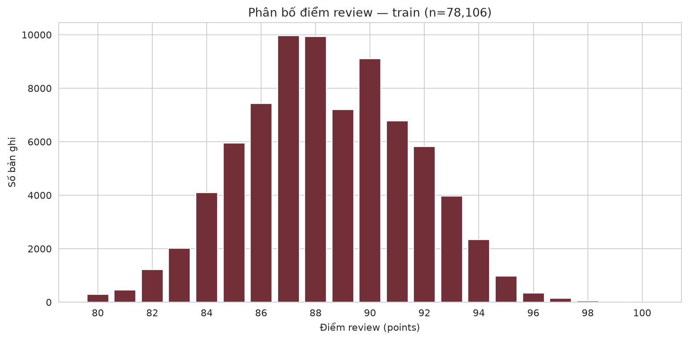

**Quan sát:** điểm trung bình **88,42**, độ lệch chuẩn **3,10**, phạm vi **80–100**. Phần lớn dữ liệu tập trung quanh các mức điểm trung tâm.

**Hàm ý:** cần so mô hình với baseline dự đoán bằng trung bình train; điểm số tập trung có thể làm một dự đoán gần trung bình trông khá tốt. Biểu đồ này chưa chứng minh mô hình học được quan hệ hữu ích. Nguồn: [thống kê số](outputs/eda/tables/numeric_summary.csv).

#### Giá phân bố thế nào và liên hệ với điểm ra sao?

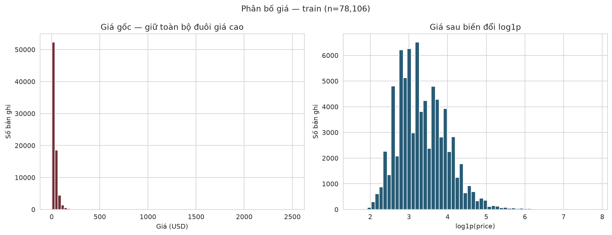

**Quan sát:** giá trung vị **25 USD**, trung bình **35,66 USD**, tối đa **2.500 USD**; giá lệch phải với đuôi cao. Hình log giúp quan sát phần giá phổ biến rõ hơn, giữ nguyên các dòng giá cao.

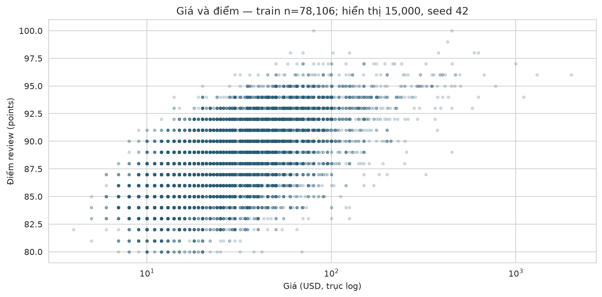

Scatter hiển thị tối đa **15.000 dòng**, seed 42, dùng trục giá log; các bảng tính trên toàn train. Không kết luận từ mật độ điểm của mẫu hiển thị rằng mọi mức giá đều có cùng số review.

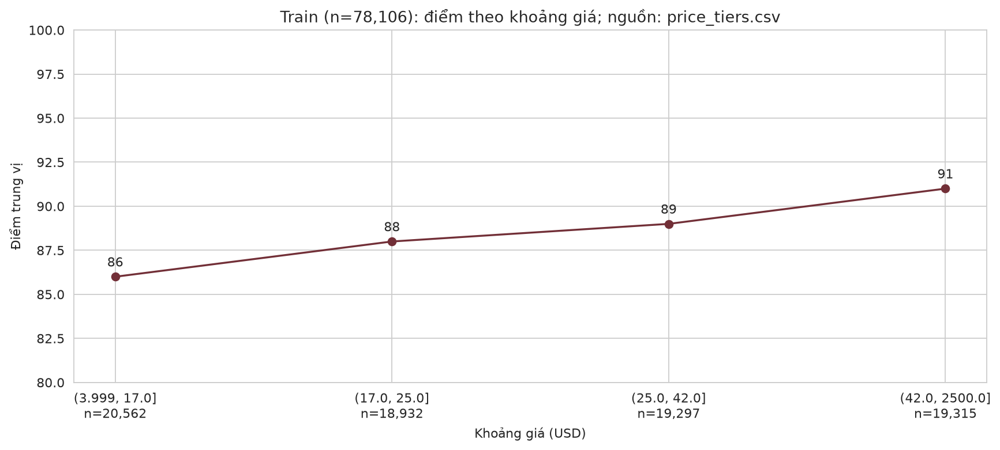

| Khoảng giá trên train | Số review | Giá trung vị (USD) | Điểm trung vị |
|---|---:|---:|---:|
| Đến 17 USD | 20.562 | 13 | 86 |
| Trên 17–25 USD | 18.932 | 21 | 88 |
| Trên 25–42 USD | 19.297 | 33 | 89 |
| Trên 42 USD | 19.315 | 60 | 91 |

**Phát hiện:** điểm trung vị tăng **86 → 88 → 89 → 91** qua bốn khoảng giá. **Quyết định:** giữ giá cao hợp lệ, dùng `log1p(price)` để biểu diễn giá lệch phải. **Giới hạn:** chưa chứng minh giá gây ra điểm cao hoặc log làm dự đoán tốt hơn; không dùng quan hệ này như khuyến nghị mua hàng. Các mốc tứ phân vị tính riêng trên train, giá bằng mốc xếp vào khoảng kết thúc ở mốc đó. Nguồn: [price_tiers.csv](outputs/eda/tables/price_tiers.csv).

#### Quốc gia, vùng và giống nho khác nhau thế nào?

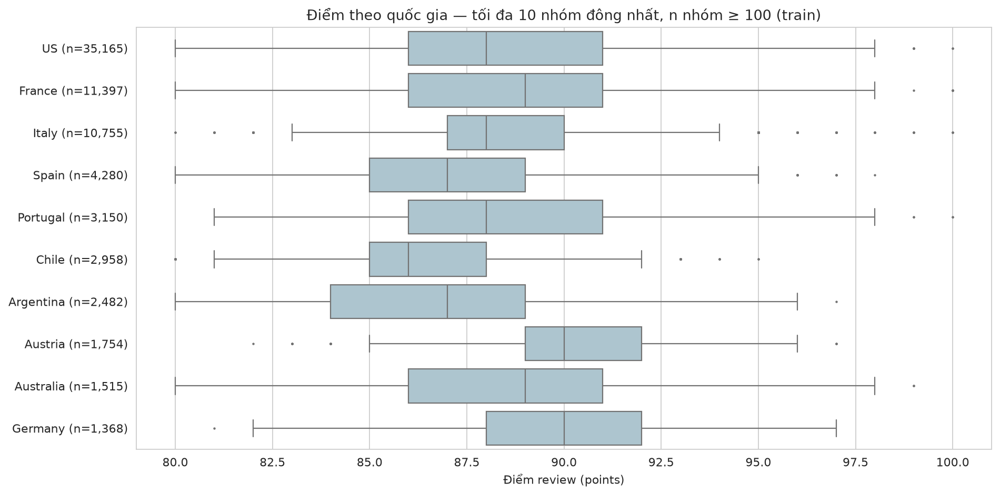

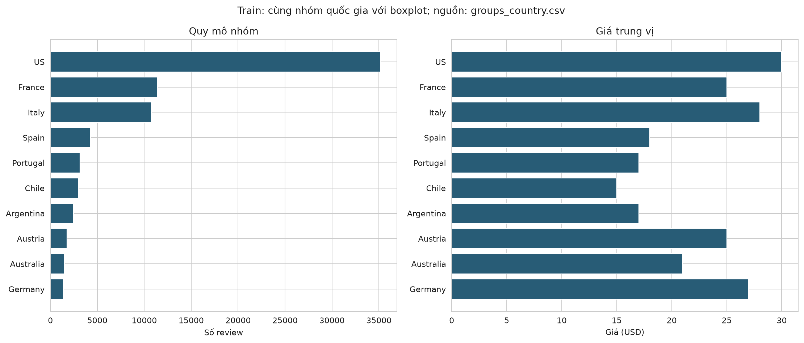

**Cách đọc:** hai hình dùng cùng tối đa 10 nhóm đông nhất có **ít nhất 100 review**, bỏ nhãn placeholder. Boxplot thể hiện cả độ phân tán; hình bên dưới đặt điểm vào bối cảnh quy mô mẫu và giá.

**Ví dụ trên train:** US có **35.165 review**, điểm trung bình khoảng **88,56**, giá trung vị **30 USD**; Austria có **1.754 review**, điểm trung bình khoảng **90,26**, giá trung vị **25 USD**. Nhóm đông nhất không đồng nghĩa nhóm điểm cao nhất.

**Giới hạn:** số review, giá, giống nho, người chấm và cơ chế tuyển chọn có thể khác nhau. Đây chưa phải so sánh đã điều chỉnh nhiễu hoặc kiểm định nhóm; không xếp hạng chất lượng rượu theo quốc gia.

Phân tích tương tự cho [vùng](outputs/eda/figures/07_province_context.png) và [giống nho](outputs/eda/figures/07_variety_context.png), kèm [bảng quốc gia](outputs/eda/tables/groups_country.csv), [bảng vùng](outputs/eda/tables/groups_province.csv), [bảng giống nho](outputs/eda/tables/groups_variety.csv).

#### Review có đặc điểm gì về độ dài và cách diễn đạt?

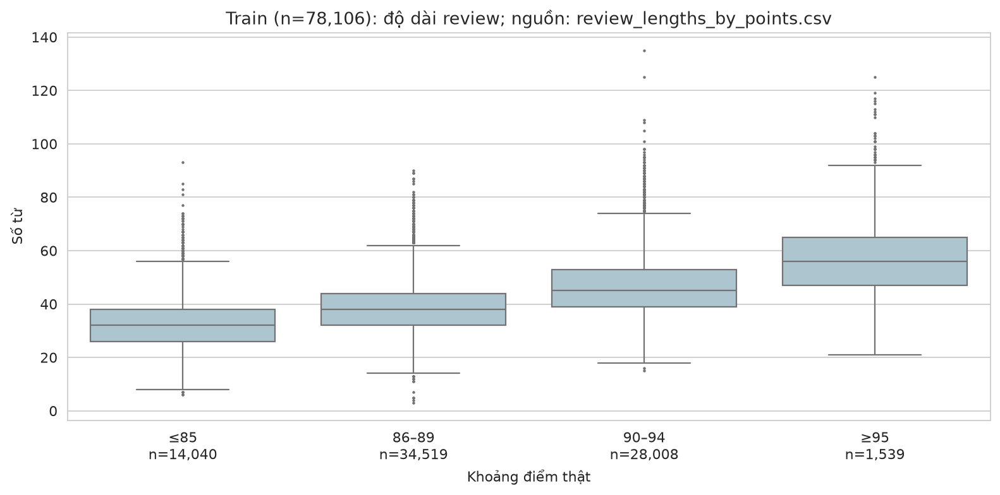

| Khoảng điểm thật trên train | Số review | Độ dài trung vị (từ) |
|---|---:|---:|
| ≤85 | 14.040 | 32 |
| 86–89 | 34.519 | 38 |
| 90–94 | 28.008 | 45 |
| ≥95 | 1.539 | 56 |

**Quan sát:** review có điểm cao hơn trong các nhóm này cũng dài hơn về trung vị. Toàn train có trung vị **40 từ**, **29 review dưới 10 từ**, không có review trống. **Hàm ý:** giữ review ngắn; độ dài là một đặc điểm mô tả cần đọc cùng bối cảnh. **Giới hạn:** chưa chứng minh viết dài làm điểm cao hơn. Nguồn: [độ dài theo nhóm](outputs/eda/tables/review_length_groups.csv), [tóm tắt review](outputs/eda/tables/review_summary.csv).

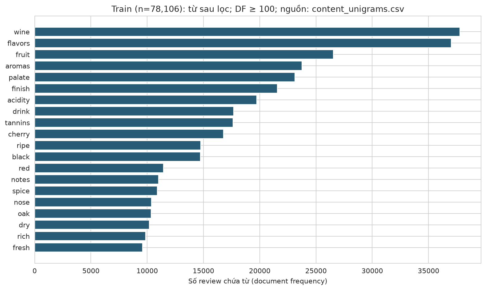

Bảng bổ sung dùng stopword tiếng Anh của scikit-learn nhưng giữ `no`, `not`, `nor`, `never`, `without`; chỉ chọn unigram có mặt trong ít nhất **100 review**, lấy top **20** theo số review chứa từ, hòa thì theo thứ tự từ. Các từ như `fruit`, `aromas`, `acidity`, `tannins` giúp nhìn nội dung mô tả trong tập dữ liệu.

[Bảng unigram gốc](outputs/eda/tables/unigrams.csv) và [bigram gốc](outputs/eda/tables/bigrams.csv) vẫn giữ stopword/phủ định. Đây là thống kê bằng `CountVectorizer`, **không phải TF-IDF hoặc hệ số mô hình**; tần suất không đo sentiment, mức ảnh hưởng lên điểm hoặc quan hệ nhân quả.

Xem [báo cáo EDA đầy đủ](outputs/eda/REPORT.md), [bảng câu hỏi–bằng chứng](outputs/eda/QUESTION_MAP.md) và [notebook](notebooks/03_eda.ipynb). Bảng/hình được sinh bằng code, không sửa số liệu bằng tay.

### 4.4. Mô hình kết hợp — đầu vào trở thành dự đoán như thế nào?

Pipeline mặc định nhận `price`, `vintage_year`, `country`, `province`, `variety`, `description` và dự đoán `points`:

- Giá được tính `log1p` ngay trong pipeline; giá và niên vụ được điền trung vị rồi chuẩn hóa.
- Quốc gia, tỉnh/vùng (`province`), giống nho được one-hot, nhóm hiếm học từ train.
- Review được TF-IDF 1–2 gram, `min_df=2`, tối đa 3.000 feature; giữ stopword và từ phủ định.
- Không dùng title, danh tính người chấm, cột audit hay đồng thời giá gốc và log giá làm predictor.

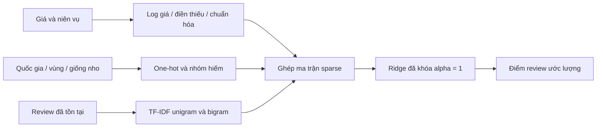

| Nhóm đầu vào | Biến đổi | Điều cần hiểu |
|---|---|---|
| Giá | `log1p(price)` → điền trung vị → z-score | Giảm chênh lệch thang đo; không dùng đồng thời giá gốc và log |
| Niên vụ | Điền trung vị → z-score | Năm thiếu được xử lý bằng thống kê train |
| Metadata | One-hot; `min_frequency=20`, `max_categories=256` | Nhóm hiếm học từ train; nhãn mới không được tự học khi dự đoán |
| Review | TF-IDF 1–2 gram; tối đa 3.000 feature | Giữ stopword/phủ định; từ chưa biết bị bỏ qua |

Mô hình đã lưu có **3.332 đặc trưng** sau ghép. Ví dụ một giá **14 USD** thành `log1p(14) ≈ 2,7081`, rồi z-score khoảng **−1,0207** theo bộ chuẩn hóa đã lưu. Đây là chuyển đổi đầu vào, không phải hệ số ảnh hưởng của giá. Xem [minh họa đặc trưng](outputs/feature_examples/REPORT.md) và [các bước số hóa](outputs/feature_examples/numeric_steps.csv).

Chọn alpha `[0.1, 1, 10, 100, 1000]` bằng CV 5 fold trên train; nối các dòng có chung title chuẩn hóa hoặc review chuẩn hóa không rỗng thành nhóm, kể cả quan hệ bắc cầu. Mỗi fold fit preprocessing độc lập. Chọn MAE trung bình nhỏ nhất, hòa thì RMSE rồi alpha nhỏ hơn. Fit pipeline cuối trên train, so với baseline trung bình train và báo validation; không fit lại bằng train + validation.

Báo MAE chính, RMSE và R² phụ, sai số theo nhóm và số mẫu. Validation có cả kết quả tổng thể lẫn tập không trùng review với train. Không làm tròn/cắt điểm trước khi tính metric. Đã đánh giá test sau khi khóa mô hình ngày 13/11/2026; xem [báo cáo test](docs/model_test_report.md). Không tuning theo kết quả test.

Lưu toàn bộ chuẩn bị đầu vào, preprocessing và Ridge trong một pipeline. Suy luận cần review đã tồn tại, không cần `points`. Đây là ước lượng điểm review, không phải dự đoán chất lượng trước khi có review. Không có thí nghiệm đối chứng để kết luận mức cải thiện do thêm review.

**Kết quả mô hình đã khóa**

| Mô hình | Tập | Số review | MAE (điểm) | RMSE (điểm) | R² |
|---|---|---:|---:|---:|---:|
| Baseline trung bình train | Validation | 16.745 | 2,5279 | 3,0821 | ≈0 |
| Ridge kết hợp | Validation | 16.745 | 1,2036 | 1,5327 | 0,7527 |
| Baseline trung bình train | Test | 16.742 | 2,5312 | 3,0932 | ≈0 |
| Ridge kết hợp | Test | 16.742 | 1,2090 | 1,5426 | 0,7513 |

Trên test, MAE giảm **52,24%** so với baseline. MAE khoảng **1,2090 điểm** là sai số tuyệt đối trung bình trên tập này; không bảo đảm từng review đều sai dưới mức đó. R² không phải tỷ lệ dự đoán đúng.

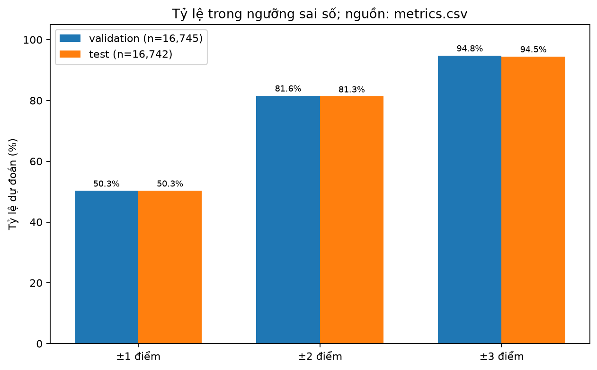

| Sai số tuyệt đối không quá | Validation | Test |
|---|---:|---:|
| 1 điểm | 50,30% | 50,32% |
| 2 điểm | 81,61% | 81,32% |
| 3 điểm | 94,80% | 94,49% |

Các ngưỡng tính cả biên. Đây là thống kê mô tả bổ sung sau đánh giá, không phải accuracy phân loại hoặc tiêu chí đã dùng để chọn mô hình. Nguồn: [metrics.csv](outputs/model_report/metrics.csv).

**Mô hình còn sai ở đâu?**

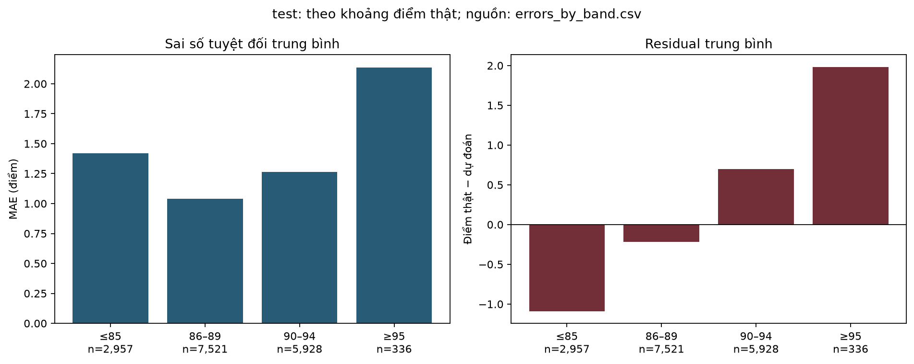

Nhóm **≥95 điểm** có **336 review test**, MAE khoảng **2,14 điểm** và residual trung bình khoảng **+1,98 điểm**: mô hình thường dự đoán thấp trong nhóm này. Nhóm **≤85 điểm** thường bị dự đoán cao. Residual được tính bằng **điểm thật − điểm dự đoán**; luôn đọc sai số cùng số mẫu. Không dùng phát hiện test để chỉnh lại mô hình.

Xem [báo cáo sai số và trường hợp validation](outputs/model_report/REPORT.md), [bảng sai số theo nhóm](outputs/model_report/errors_by_band.csv). Đối chiếu sau khi loại khỏi phép tính **5 dòng test trùng review train** cho MAE khoảng **1,2089**, gần kết quả tổng thể; điều này không loại trừ near-duplicate hoặc mọi rủi ro leakage.

### 4.5. Thống kê khám phá — giá và điểm có quan hệ đơn điệu không?

Đã bổ sung Spearman giá–điểm ở cấp nhóm title train, p-value hai phía xấp xỉ và CI95% từ 2.000 bootstrap nhóm (seed 42). Đây là phân tích sau EDA, chưa kiểm soát nhiễu hoặc bảo đảm độc lập giữa các nhóm; xem [báo cáo thống kê](outputs/analysis/REPORT.md). Không coi là kiểm định đăng ký trước.

| Thành phần | Kết quả / phương pháp |
|---|---|
| Đơn vị phân tích | **77.437 nhóm title chuẩn hóa** trên train; mỗi nhóm lấy trung vị giá và điểm |
| Spearman rho | **0,6158** |
| Khoảng tin cậy 95% | **[0,6110; 0,6202]**, bootstrap percentile |
| Bootstrap | **2.000** lần lấy mẫu lại nhóm, seed **42** |
| Kiểm định | Hai phía, p-value xấp xỉ; ngưỡng tham khảo 0,05 |

**Diễn giải:** giá và điểm có liên hệ đơn điệu dương trong mẫu nhóm title train. Hệ số không có nghĩa “giá tăng 1 USD làm điểm tăng 0,616”. P-value trong file trả về 0 do giới hạn biểu diễn số thực; không diễn giải là xác suất đúng bằng 0. Giá và log giá giữ cùng thứ hạng, nên không kiểm định hai lần.

**Giới hạn:** phân tích được bổ sung sau EDA; chưa điều chỉnh quốc gia, giống nho hoặc người chấm. Các nhóm title vẫn có thể phụ thuộc qua winery/người chấm, khiến CI và p-value lạc quan. Không suy luận nhân quả. Nguồn: [bảng thống kê](outputs/analysis/price_points_spearman.csv), [báo cáo và provenance](outputs/analysis/REPORT.md).

## 5. Cấu trúc repository

```text
wine-quality-prediction/
├── data/
│   ├── raw/                      # Nguồn bất biến
│   ├── interim/                  # Output cleaning trung gian
│   └── processed/
│       ├── wine_cleaned_final.csv
│       └── splits/               # train.csv, val.csv, test.csv
├── notebooks/
│   ├── 00_data_understanding.ipynb
│   ├── 01_outliers_and_noise.ipynb
│   ├── 02_data_split.ipynb
│   └── 03_eda.ipynb
├── src/                          # Cleaning, split, hàm EDA dùng chung
├── outputs/
│   ├── eda/                      # Hình, bảng và báo cáo EDA
│   ├── cleaning_report/          # Bằng chứng cleaning trước/sau
│   ├── analysis/                 # Spearman và CI bootstrap
│   ├── model_report/             # Metric và phân tích sai số từ dự đoán đã lưu
│   ├── feature_examples/         # Minh họa encoder đã lưu
│   ├── demo/                     # Ví dụ đầu ra dự đoán
│   └── quality/                  # Kết quả kiểm chứng
├── docs/                         # Audit, cleaning, dictionary, báo cáo
├── tests/                        # Kiểm tra dữ liệu và logic
├── requirements.txt
├── wine_encoding/               # Encoding, combined pipeline, CV/train/verify/predict
└── README.md
```

Tổ chức theo chức năng; không có thư mục phần việc cá nhân. [Chi tiết cấu trúc](docs/PROJECT_STRUCTURE.md).

## 6. Cài đặt và chạy lại

Chạy từ thư mục gốc repository. Yêu cầu Python **3.10 trở lên**, dữ liệu raw đúng tên/checksum. Môi trường hiện có có thể dùng trực tiếp; nếu tạo môi trường mới trên Windows:

```powershell
python -m venv .venv
.\.venv\Scripts\Activate.ps1
python -m pip install -r requirements.txt
```

**Bước 1 — Cleaning:** tái tạo dữ liệu trung gian và cleaned data từ raw, kiểm tra schema và checksum; ghi lại các file output cleaning.

```powershell
python src/pipeline.py
```

**Bước 2 — Kiểm tra split đã lưu:** không ghi đè các CSV.

```powershell
python src/split_data.py
```

Nếu chưa có split, dùng lệnh sau để tạo theo quy tắc đã khóa; file đã có phải khớp trước khi chấp nhận:

```powershell
python src/split_data.py --write
```

**Bước 3 — Tạo EDA và bảng audit trùng review:** ghi bảng/hình vào `outputs/eda/`.

```powershell
python src/create_eda_plots.py
```

**Bước 4 — Sinh các báo cáo bổ sung từ dữ liệu/artifact hiện có:**

```powershell
python -m src.cleaning_report
python -m src.analyze_associations
python -m wine_encoding.src.report_results
python -m wine_encoding.src.explain_features
```

`cleaning_report` chỉ tái tạo trong bộ nhớ và đối chiếu cleaned; không ghi lại dữ liệu. Ba lệnh còn lại không fit mô hình. Các lệnh hỗ trợ `--output-dir`, xuất vào `outputs/cleaning_report`, `analysis`, `model_report`, `feature_examples`. Mỗi báo cáo có checksum, phạm vi và phiên bản. Chạy các bước này trước notebook EDA.

**Bước 5 — Xem notebook:** chọn kernel `.venv`, Restart Kernel và Run All. Thứ tự: tìm hiểu dữ liệu → audit outlier/noise → kiểm tra split → EDA. Notebook outlier là nghiên cứu quyết định cleaning đã có, không phải bước cleaning riêng cần ghép thêm vào pipeline.

```powershell
jupyter notebook
```

**Bước 6 — Kiểm tra tự động:**

```powershell
python -m unittest discover -s tests -v
```

Không cần tải dữ liệu từ mạng khi chạy nếu file raw đã có. Không chạy lại bước cài môi trường để thay đổi môi trường đang hoạt động chỉ nhằm tái tạo hình.

**Luồng tái huấn luyện độc lập — chỉ dùng khi chủ động tạo thí nghiệm mới:**

```powershell
python -m wine_encoding.src.prepare
python -m wine_encoding.src.verify
python -m wine_encoding.src.train
python -m wine_encoding.src.verify_model
python -m wine_encoding.src.predict --input wine_encoding/examples/new_wines.csv
```

Không cần chạy luồng này để xem/sinh lại báo cáo hiện tại. Các lệnh prepare/train ghi lại artifact và yêu cầu quản lý phiên bản thí nghiệm riêng. Chạy từ repo root. Prepare đối chiếu split đã khóa trước khi xuất; train CV từ dữ liệu chưa mã hóa. Model mới ở `wine_encoding/outputs/model_combined/`, không dùng artifact product cũ thay thế. Xem [hướng dẫn mô hình](wine_encoding/README.md) để biết input, output và lệnh đánh giá test tách riêng.

### Chạy thử một dự đoán từ pipeline đã lưu

```powershell
python -m wine_encoding.src.predict --input wine_encoding/examples/new_wines.csv --output outputs/demo/new_predictions.csv
```

| Dòng trong CSV ví dụ | Đầu vào tóm tắt | Điểm dự đoán |
|---|---|---:|
| 1 | France, Burgundy, Chardonnay, 30 USD, niên vụ 2014 và review đã có | 88,618 |
| 2 | Italy, Tuscany, Red Blend, thiếu giá/năm và review đã có | 85,553 |

Kết quả từ [CSV demo](outputs/demo/new_predictions.csv); các dòng này không có nhãn thật nên không tính được MAE cho demo. Giá/năm thiếu dùng trung vị train; review trống thành vector văn bản 0; nhãn phân loại mới vào nhóm hiếm nếu có, nếu không khối tương ứng bằng 0. Không có đánh giá riêng bảo đảm hiệu năng cho mọi trường hợp thiếu đầu vào.

File đầu ra giữ thứ tự dòng, thêm `points_predicted` và `prediction_outside_train_target_range`. Cờ ngoài khoảng train không tự cắt hoặc làm tròn dự đoán. Xem [hướng dẫn demo](docs/DEMO.md).

### Kiểm chứng kết quả hiện tại

| Kiểm tra | Kết quả đã ghi nhận |
|---|---|
| Kiểm thử tự động | **40/40** đạt |
| Notebook bằng kernel mới | **4/4** chạy thành công |
| Mô hình đã lưu | Dự đoán validation, metric và chọn alpha được đối chiếu thành công |
| Dữ liệu/artifact bảo vệ | **63 file** không đổi checksum trong đợt hoàn thiện |
| Báo cáo và hình | Provenance đầu vào khớp, liên kết cục bộ hợp lệ; hình mới đã kiểm tra trực quan |

Nguồn: [nghiệm thu](outputs/quality/acceptance.json), [kiểm tra toàn dự án](outputs/quality/verification.json). Đây là kết quả của lần kiểm chứng đã lưu, không phải trạng thái CI cập nhật tự động.

```powershell
python scripts/verify_notebooks.py
python scripts/verify_reports.py
```

Kiểm tra notebook cần dữ liệu và các báo cáo theo hướng dẫn trên. Báo cáo mô hình/đặc trưng cần artifact trong `wine_encoding/outputs/` — thư mục này được gitignore và không tự có khi clone mới. Provenance của artifact hiện có chứa đường dẫn tuyệt đối của máy tạo; di chuyển môi trường có thể cần tái tạo artifact trong một thí nghiệm độc lập. Các báo cáo, hình và bảng đã commit vẫn đọc được trực tiếp trên GitHub.

## 7. Kết quả hiện có và trạng thái

| Hạng mục | Trạng thái |
|---|---|
| Audit, cleaning và validation | Đã có pipeline và báo cáo |
| Split | Đã có; tái tạo đúng bộ hiện tại, seed 42 |
| EDA hướng kết hợp | Đã có notebook, bảng và hình trên train |
| Review trùng giữa split | Giữ split; báo metric validation tổng thể và không trùng train |
| Thống kê giá–điểm | Đã bổ sung phân tích khám phá ở cấp nhóm title train; không đăng ký trước |
| TF-IDF + Ridge kết hợp | Đã triển khai CV theo nhóm, pipeline train và suy luận |
| MAE, RMSE, R² | Đã có validation và test; test MAE 1,208998, RMSE 1,542601, R² 0,751284 |

Các quan sát mô tả trên **78.106 review train**:

- Điểm trung bình **88,42**, độ lệch chuẩn **3,10**, phạm vi **80–100**.
- Giá trung vị **25 USD**, trung bình **35,66 USD**, tối đa **2.500 USD**.
- Điểm trung vị theo bốn khoảng giá tăng từ **86** đến **91**; chưa suy ra nhân quả.
- Review dài trung vị **40 từ**; **29** review dưới 10 từ, không có review trống trên train.

Các số EDA trên là mô tả dữ liệu. Kết quả dự đoán được tạo riêng tại `wine_encoding/outputs/model_combined/RESULTS.md`; xem [báo cáo validation đã kiểm chứng](docs/model_validation_report.md) và [đánh giá test cuối](docs/model_test_report.md). Kết quả dự đoán và phân tích thống kê khám phá trả lời các câu hỏi khác nhau; không suy luận nhân quả.

## 8. Giới hạn và sử dụng kết quả

- Review và điểm đều gắn với người đánh giá. Dự đoán tốt từ review có thể phản ánh cách diễn đạt chứa thông tin về điểm.
- Mô hình cần review làm đầu vào nên không được mô tả là dự đoán trước khi lời review tồn tại.
- Mẫu có giá có thể khác nhóm thiếu giá; quốc gia, vùng và giống nho không cân bằng.
- Dataset chỉ bao phủ sản phẩm được chọn để đánh giá, không đại diện toàn thị trường rượu.
- Quan hệ giá–điểm không chứng minh giá cao tạo ra chất lượng cao. Không dùng tỷ lệ điểm/giá như khuyến nghị mua hàng chắc chắn.
- Từ phổ biến hoặc hệ số mô hình không chứng minh quan hệ nhân quả.
- Trùng văn bản giữa split và lịch sử sử dụng holdout phải được công bố khi đánh giá.

## 9. Tài liệu và khả năng tái lập

- [Data audit](docs/data_audit.md), [Data dictionary](docs/data_dictionary.md).
- [Missing values](docs/missing_values_report.md), [consistency và duplicate](docs/report_dat_consistency_duplicates.md).
- [Outlier và noise](docs/outliers_and_noise_report.md), [cleaning log](docs/cleaning_log.csv).
- [Báo cáo split](docs/data_split_report.md), [báo cáo EDA](docs/eda_report.md).
- [Bằng chứng cleaning](outputs/cleaning_report/REPORT.md), [thống kê](outputs/analysis/REPORT.md), [sai số bổ sung](outputs/model_report/REPORT.md), [đặc trưng](outputs/feature_examples/REPORT.md).
- [Môi trường đã kiểm chứng](requirements-reproducible.txt), [hướng dẫn demo](docs/DEMO.md).

Raw data bất biến; biến đổi bằng code, không sửa CSV thủ công. Giữ seed và quy tắc chia nhóm, kiểm tra bản ghi và preprocessing, chạy notebook từ kernel mới. Mọi con số trong báo cáo phải truy ngược được tới bảng, hình và code; không ghi kết quả dự kiến như kết quả đã đạt.
