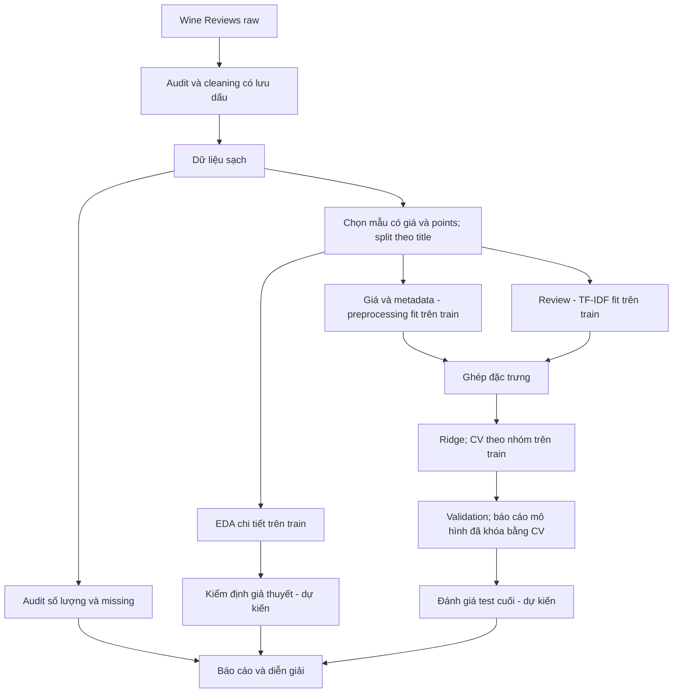

# Phân tích và dự đoán điểm review rượu từ thông tin sản phẩm và văn bản

Dự án sử dụng **Wine Reviews 130k** để tìm hiểu quan hệ giữa giá, đặc điểm sản phẩm, nội dung đánh giá và điểm review `points`. Mô hình chính là **kết hợp thông tin sản phẩm đã mã hóa với vector TF-IDF của review, rồi dùng Ridge để dự đoán điểm**.

Đơn vị quan sát là **một bản ghi review**, không mặc định là một chai rượu duy nhất. Một tên rượu có thể có nhiều review. `points` là đánh giá của người chấm, không phải phép đo chất lượng khách quan.

## 1. Bối cảnh và câu hỏi nghiên cứu

Người mua thường tham khảo giá, xuất xứ, giống nho và lời đánh giá khi lựa chọn rượu. Tuy nhiên, giá cao không bảo đảm mọi review đều cho điểm cao; dữ liệu cũng có sự khác nhau về nhóm sản phẩm và người chấm. Nhóm dùng phân tích dữ liệu để mô tả những liên hệ này và xây dựng một quy trình dự đoán có thể kiểm tra lại.

**Câu hỏi chính:** Kết hợp thông tin sản phẩm và nội dung review dự đoán điểm đánh giá rượu tốt đến đâu?

Các câu hỏi hỗ trợ:

1. Giá và điểm review có quan hệ như thế nào? Xu hướng giữa các khoảng giá có giống nhau không?
2. Điểm và số lượng review khác nhau như thế nào giữa các quốc gia, vùng và giống nho?
3. Văn bản review có đặc điểm gì về độ dài và từ/cụm từ phổ biến?
4. Mô hình kết hợp còn sai ở những nhóm nào, và kết quả có giới hạn gì khi sử dụng?

Một mô hình kết hợp duy nhất **chưa chứng minh review cải thiện dự đoán bao nhiêu**. Muốn trả lời riêng điều này cần bổ sung mô hình chỉ thông tin sản phẩm để đối chiếu trên cùng bản ghi và split. So sánh A/B/C không phải yêu cầu triển khai hiện tại.

## 2. Nhiệm vụ và đầu ra của dự án

| Công việc | Mục đích | Đầu ra |
|---|---|---|
| Audit | Hiểu schema, missing, duplicate và miền giá trị | Data dictionary, báo cáo audit |
| Cleaning | Xử lý thiếu, không nhất quán, trùng và lỗi giá có lưu dấu | Dữ liệu sạch, cleaning log |
| Chọn mẫu và split | Tách dữ liệu theo nhóm tên rượu | CSV train/validation/test, kiểm tra tái lập |
| EDA | Mô tả giá, điểm, metadata và review | Notebook, bảng CSV, biểu đồ |
| Kiểm định — dự kiến | Kiểm tra các giả thuyết định trước | Hệ số, độ lớn khác biệt, khoảng tin cậy và giới hạn |
| Preprocessing | Mã hóa sản phẩm và vector hóa review | Bộ xử lý fit trên train |
| Modeling | Học ánh xạ từ đặc trưng kết hợp sang điểm | Pipeline Ridge + preprocessing |
| Đánh giá validation | Đo sai số tổng thể và theo nhóm | MAE, RMSE, R², dự đoán và phân tích phần dư |
| Báo cáo | Kết nối phát hiện với câu hỏi và giới hạn | Báo cáo và phần trình bày có bằng chứng |

Đã triển khai pipeline **metadata + TF-IDF review → Ridge**, chọn alpha bằng CV theo nhóm trên train và báo cáo validation. Chưa đánh giá test trong luồng này và chưa chạy kiểm định chính thức. Không dùng embedding; web/API không thuộc đầu ra hiện tại.

## 3. Dữ liệu và vai trò biến

- Nguồn: [Kaggle — Wine Reviews](https://www.kaggle.com/datasets/zynicide/wine-reviews).
- Giấy phép theo tài liệu nguồn đã ghi nhận trong dự án: **CC BY-NC-SA 4.0**; cần tuân thủ điều kiện khi chia sẻ/sử dụng.
- Raw: `data/raw/winemag-data-130k-v2.csv`, **129.971 dòng × 14 cột**.
- Cleaned: `data/processed/wine_cleaned_final.csv`, **119.988 dòng × 19 cột**.
- Sau cleaning có **111.593 dòng có giá quan sát**; **8.395 dòng thiếu giá** vẫn được giữ để audit.
- SHA-256 raw: `52af2643c8ac29f010f0cc629dfbdda1c74aa0f332d11762af9ef3de4e567ac9`.

| Biến | Vai trò trong mô hình | Xử lý |
|---|---|---|
| `points` | Nhãn mục tiêu | Hồi quy điểm review, không đưa vào đầu vào |
| `price` / `log_price` | Giá sản phẩm | Dùng `log1p(price)` với giá quan sát; không dùng đồng thời hai biểu diễn mặc định |
| `country`, `province`, `variety` | Metadata chính; vùng dùng `province` | Nhãn thiếu và one-hot; nhóm hiếm nếu cần, học trên train |
| `vintage_year` | Niên vụ trích từ tiêu đề | Điền năm thiếu và chuẩn hóa bằng thống kê train |
| `description` | Review của người đánh giá rượu | TF-IDF unigram/bigram fit trên train |
| `title` | Chia nhóm và trích niên vụ | Không dùng nguyên văn làm predictor |
| `taster_name`, `taster_twitter_handle` | Audit và phân tích bias | Không làm predictor chính |
| `region_1`, `region_2`, `winery`, `designation` | Dữ liệu bổ trợ | Chưa chọn làm predictor mặc định |
| `price_original`, `price_was_missing`, `price_was_corrected`, `is_non_informative_review` | Theo dõi xử lý dữ liệu | Không làm predictor |

Chi tiết schema raw và cleaned: [Data Dictionary](docs/data_dictionary.md). `description` là lời của người đánh giá trong dataset; không mặc định gọi là review của khách hàng/người dùng.

## 4. Quy trình từ đầu đến cuối



### 4.1. Cleaning hiện có

Pipeline xử lý missing → consistency → duplicate hoàn toàn → outlier/noise → validation. Giữ giá thiếu, không biến giá ước tính thành quan sát. Hai hiệu chỉnh giá được giữ cùng trường audit; đây là quyết định có lưu vết, không coi là bằng chứng độc lập về giá thị trường. Giá cao hợp lệ và điểm 100 vẫn được giữ. Review ngắn chỉ được gắn cờ, không tự động loại.

### 4.2. Split đã khóa

Mẫu hiện tại là bản ghi có `price` và `points`, chia bằng hai bước `GroupShuffleSplit` theo `title` chuẩn hóa, seed **42**, tỷ lệ nhóm xấp xỉ **70/15/15**:

| Tập | Số bản ghi | Số nhóm title |
|---|---:|---:|
| Train | 78.106 | 77.437 |
| Validation | 16.745 | 16.594 |
| Test | 16.742 | 16.594 |

Không có nhóm title giao nhau. Module split mới tái tạo trong bộ nhớ và đối chiếu đúng thứ tự bản ghi với file đã lưu; mặc định không ghi dữ liệu. `--write` chỉ tạo file chưa có, từ chối nếu file đã có khác kết quả tái tạo.

**Audit văn bản phát hiện review trùng dù title khác:** train–validation có **6**, train–test **5**, validation–test **1** chuỗi review phân biệt dùng chung sau chuyển chữ thường và gộp khoảng trắng. Các con số là giao theo từng cặp, không phải số dòng hoặc tổng số chuỗi duy nhất toàn cục. Giữ nguyên split và mọi bản ghi. Báo cáo mô hình có metric validation tổng thể và metric riêng sau khi bỏ khỏi phép tính các dòng có review trùng train (6 dòng); không dùng hai kết quả để tuning. Đây là audit trùng chính xác sau chuẩn hóa, chưa xử lý near-duplicate và không chứng minh không có leakage.

**Lịch sử:** split seed 42 được chốt ngày 21/10/2026; EDA trước đây đã xem toàn mẫu có giá và holdout này từng được thử. Không khẳng định test chưa từng được quan sát; không đổi seed để chọn kết quả thuận lợi.

### 4.3. EDA hiện tại

Audit schema/missing dùng toàn cleaned data. Phân tích giá, điểm, metadata và review dùng **train**. Validation/test chỉ được đọc cột review cho báo cáo trùng văn bản, không phân tích nhãn để chọn cấu hình.

- Phân bố điểm; histogram giá gốc và `log1p(price)` giữ toàn đuôi giá cao.
- Scatter giá–điểm trên trục log; hiển thị tối đa 15.000 dòng seed 42; bảng dùng toàn train.
- Bảng khoảng giá theo tứ phân vị tính trên train.
- Bảng nhóm quốc gia/vùng/giống nho có số mẫu và số giá thiếu; biểu đồ tối đa 10 nhóm đông nhất đạt 100 dòng, bỏ nhãn placeholder khỏi so sánh điểm.
- Độ dài review và unigram/bigram phổ biến. Đếm tần suất bằng `CountVectorizer` trên train, giữ stopword và từ phủ định. Không phải TF-IDF của mô hình; tần suất không phải mức ảnh hưởng đến điểm.

Kết quả được tạo bằng code, không sửa bằng tay. [Notebook EDA](notebooks/03_eda.ipynb) có nhận xét và giới hạn; [báo cáo EDA](docs/eda_report.md) dẫn tới bảng/hình.

### 4.4. Mô hình kết hợp và kiểm định

Pipeline mặc định nhận `price`, `vintage_year`, `country`, `province`, `variety`, `description` và dự đoán `points`:

- Giá được tính `log1p` ngay trong pipeline; giá và niên vụ được điền trung vị rồi chuẩn hóa.
- Quốc gia, tỉnh/vùng (`province`), giống nho được one-hot, nhóm hiếm học từ train.
- Review được TF-IDF 1–2 gram, `min_df=2`, tối đa 3.000 feature; giữ stopword và từ phủ định.
- Không dùng title, danh tính người chấm, cột audit hay đồng thời giá gốc và log giá làm predictor.

Chọn alpha `[0.1, 1, 10, 100, 1000]` bằng CV 5 fold trên train; nối các dòng có chung title chuẩn hóa hoặc review chuẩn hóa không rỗng thành nhóm, kể cả quan hệ bắc cầu. Mỗi fold fit preprocessing độc lập. Chọn MAE trung bình nhỏ nhất, hòa thì RMSE rồi alpha nhỏ hơn. Fit pipeline cuối trên train, so với baseline trung bình train và báo validation; không fit lại bằng train + validation.

Báo MAE chính, RMSE và R² phụ, sai số theo nhóm và số mẫu. Validation có cả kết quả tổng thể lẫn tập không trùng review với train. Không làm tròn/cắt điểm trước khi tính metric. Chưa đánh giá test; lệnh đánh giá test riêng chỉ dùng sau khi đã khóa mô hình, không tuning theo kết quả test.

Lưu toàn bộ chuẩn bị đầu vào, preprocessing và Ridge trong một pipeline. Suy luận cần review đã tồn tại, không cần `points`. Đây là ước lượng điểm review, không phải dự đoán chất lượng trước khi có review. Không có thí nghiệm đối chứng để kết luận mức cải thiện do thêm review.

Kiểm định thống kê chính thức chưa chạy; các giả thuyết và phương pháp phải được chốt riêng trước khi phân tích.

## 5. Cấu trúc repository

```text
wine-quality-prediction/
├── data/
│   ├── raw/                      # Nguồn bất biến
│   ├── interim/                  # Output cleaning trung gian
│   └── processed/
│       ├── wine_cleaned_final.csv
│       └── splits/               # train.csv, val.csv, test.csv
├── notebooks/
│   ├── 00_data_understanding.ipynb
│   ├── 01_outliers_and_noise.ipynb
│   ├── 02_data_split.ipynb
│   └── 03_eda.ipynb
├── src/                          # Cleaning, split, hàm EDA dùng chung
├── outputs/eda/
│   ├── figures/                  # PNG xuất từ code
│   └── tables/                   # CSV mô tả và audit
├── docs/                         # Audit, cleaning, dictionary, báo cáo
├── tests/                        # Kiểm tra dữ liệu và logic
├── requirements.txt
├── wine_encoding/               # Encoding, combined pipeline, CV/train/verify/predict
└── README.md
```

Tổ chức theo chức năng; không có thư mục phần việc cá nhân. [Chi tiết cấu trúc](docs/PROJECT_STRUCTURE.md).

## 6. Cài đặt và chạy lại

Chạy từ thư mục gốc repository. Yêu cầu Python **3.10 trở lên**, dữ liệu raw đúng tên/checksum. Môi trường hiện có có thể dùng trực tiếp; nếu tạo môi trường mới trên Windows:

```powershell
python -m venv .venv
.\.venv\Scripts\Activate.ps1
python -m pip install -r requirements.txt
```

**Bước 1 — Cleaning:** tái tạo dữ liệu trung gian và cleaned data từ raw, kiểm tra schema và checksum; ghi lại các file output cleaning.

```powershell
python src/pipeline.py
```

**Bước 2 — Kiểm tra split đã lưu:** không ghi đè các CSV.

```powershell
python src/split_data.py
```

Nếu chưa có split, dùng lệnh sau để tạo theo quy tắc đã khóa; file đã có phải khớp trước khi chấp nhận:

```powershell
python src/split_data.py --write
```

**Bước 3 — Tạo EDA và bảng audit trùng review:** ghi bảng/hình vào `outputs/eda/`.

```powershell
python src/create_eda_plots.py
```

**Bước 4 — Xem notebook:** chọn kernel `.venv`, Restart Kernel và Run All. Thứ tự: tìm hiểu dữ liệu → audit outlier/noise → kiểm tra split → EDA. Notebook outlier là nghiên cứu quyết định cleaning đã có, không phải bước cleaning riêng cần ghép thêm vào pipeline.

```powershell
jupyter notebook
```

**Bước 5 — Kiểm tra tự động:**

```powershell
python -m unittest discover -s tests -v
```

Không cần tải dữ liệu từ mạng khi chạy nếu file raw đã có. Không chạy lại bước cài môi trường để thay đổi môi trường đang hoạt động chỉ nhằm tái tạo hình.

**Bước 6 — Encoding và mô hình kết hợp:**

```powershell
python -m wine_encoding.src.prepare
python -m wine_encoding.src.verify
python -m wine_encoding.src.train
python -m wine_encoding.src.verify_model
python -m wine_encoding.src.predict --input wine_encoding/examples/new_wines.csv
```

Chạy từ repo root. Prepare đối chiếu split đã khóa trước khi xuất; train CV từ dữ liệu chưa mã hóa. Model mới ở `wine_encoding/outputs/model_combined/`, không dùng artifact product cũ thay thế. Xem [hướng dẫn mô hình](wine_encoding/README.md) để biết input, output và lệnh đánh giá test tách riêng.

## 7. Kết quả hiện có và trạng thái

| Hạng mục | Trạng thái |
|---|---|
| Audit, cleaning và validation | Đã có pipeline và báo cáo |
| Split | Đã có; tái tạo đúng bộ hiện tại, seed 42 |
| EDA hướng kết hợp | Đã có notebook, bảng và hình trên train |
| Review trùng giữa split | Giữ split; báo metric validation tổng thể và không trùng train |
| Kiểm định chính thức | Chưa thực hiện |
| TF-IDF + Ridge kết hợp | Đã triển khai CV theo nhóm, pipeline train và suy luận |
| MAE, RMSE, R² | Báo cáo validation được tạo bằng train; test chưa đánh giá |

Các quan sát mô tả trên **78.106 review train**:

- Điểm trung bình **88,42**, độ lệch chuẩn **3,10**, phạm vi **80–100**.
- Giá trung vị **25 USD**, trung bình **35,66 USD**, tối đa **2.500 USD**.
- Điểm trung vị theo bốn khoảng giá tăng từ **86** đến **91**; chưa suy ra nhân quả.
- Review dài trung vị **40 từ**; **29** review dưới 10 từ, không có review trống trên train.

Các số EDA trên là mô tả dữ liệu. Kết quả dự đoán được tạo riêng tại `wine_encoding/outputs/model_combined/RESULTS.md`; xem [báo cáo validation đã kiểm chứng](docs/model_validation_report.md). Kết quả này không thay thế kiểm định thống kê.

## 8. Giới hạn và sử dụng kết quả

- Review và điểm đều gắn với người đánh giá. Dự đoán tốt từ review có thể phản ánh cách diễn đạt chứa thông tin về điểm.
- Mô hình cần review làm đầu vào nên không được mô tả là dự đoán trước khi lời review tồn tại.
- Mẫu có giá có thể khác nhóm thiếu giá; quốc gia, vùng và giống nho không cân bằng.
- Dataset chỉ bao phủ sản phẩm được chọn để đánh giá, không đại diện toàn thị trường rượu.
- Quan hệ giá–điểm không chứng minh giá cao tạo ra chất lượng cao. Không dùng tỷ lệ điểm/giá như khuyến nghị mua hàng chắc chắn.
- Từ phổ biến hoặc hệ số mô hình không chứng minh quan hệ nhân quả.
- Trùng văn bản giữa split và lịch sử sử dụng holdout phải được công bố khi đánh giá.

## 9. Tài liệu và khả năng tái lập

- [Data audit](docs/data_audit.md), [Data dictionary](docs/data_dictionary.md).
- [Missing values](docs/missing_values_report.md), [consistency và duplicate](docs/report_dat_consistency_duplicates.md).
- [Outlier và noise](docs/outliers_and_noise_report.md), [cleaning log](docs/cleaning_log.csv).
- [Báo cáo split](docs/data_split_report.md), [báo cáo EDA](docs/eda_report.md).

Raw data bất biến; biến đổi bằng code, không sửa CSV thủ công. Giữ seed và quy tắc chia nhóm, kiểm tra bản ghi và preprocessing, chạy notebook từ kernel mới. Mọi con số trong báo cáo phải truy ngược được tới bảng, hình và code; không ghi kết quả dự kiến như kết quả đã đạt.
