# EDA — câu hỏi, bằng chứng và giới hạn

Audit missing dùng cleaned; mọi phân tích giá, điểm, metadata và từ vựng dùng train. Holdout chỉ đọc description để audit trùng chuỗi.

## 1. Giá liên hệ với điểm ra sao?

**Cách đọc:** histogram so phân phối gốc/log; scatter dùng trục giá log; biểu đồ khoảng giá so điểm trung vị với số mẫu.

**Kết quả:** giá trung vị 25 USD, trung bình 35.66 USD; điểm trung vị theo khoảng giá là 86 → 88 → 89 → 91.

| price_interval_usd | rows | price_median | points_median | points_mean |
| --- | --- | --- | --- | --- |
| (3.999, 17.0] | 20562 | 13.0 | 86.0 | 86.081 |
| (17.0, 25.0] | 18932 | 21.0 | 88.0 | 87.73 |
| (25.0, 42.0] | 19297 | 33.0 | 89.0 | 88.975 |
| (42.0, 2500.0] | 19315 | 60.0 | 91.0 | 91.015 |

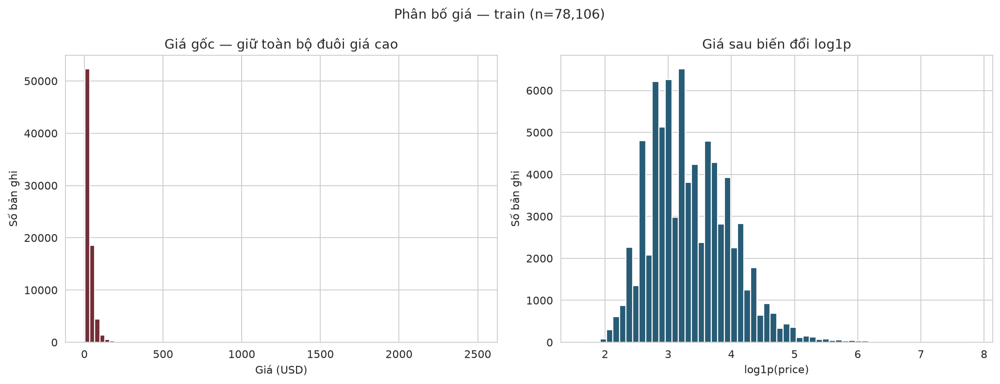

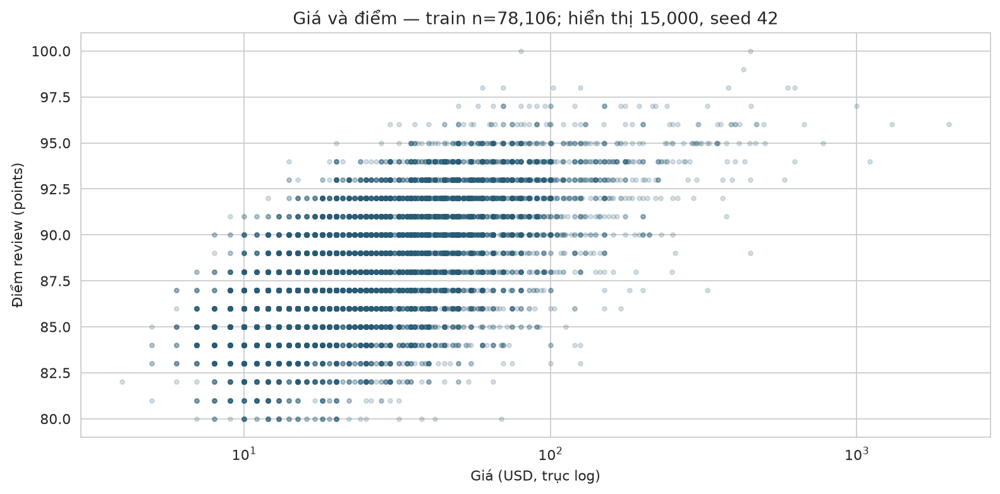

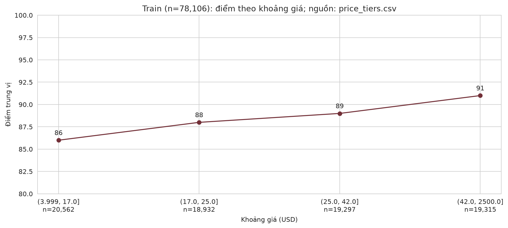

**Hàm ý:** giữ giá cao hợp lệ; log giúp biểu diễn giá lệch phải. **Giới hạn:** chưa chứng minh log cải thiện dự đoán hoặc giá gây ra điểm cao. Nguồn: numeric_summary.csv, price_tiers.csv trong tables/.

## Nhóm country: quy mô, giá và điểm khác nhau ra sao?

**Cách đọc:** hai hình dùng cùng tối đa 10 nhóm đông nhất có ít nhất 100 review; boxplot cho thấy trung vị và khoảng tứ phân vị, hình bối cảnh cho quy mô và giá.

| country | rows | missing_price | price_median | points_mean | points_median | points_q25 | points_q75 |
| --- | --- | --- | --- | --- | --- | --- | --- |
| US | 35165 | 0 | 30.0 | 88.56 | 88.0 | 86.0 | 91.0 |
| France | 11397 | 0 | 25.0 | 88.762 | 89.0 | 86.0 | 91.0 |
| Italy | 10755 | 0 | 28.0 | 88.64 | 88.0 | 87.0 | 90.0 |
| Spain | 4280 | 0 | 18.0 | 87.235 | 87.0 | 85.0 | 89.0 |
| Portugal | 3150 | 0 | 17.0 | 88.382 | 88.0 | 86.0 | 91.0 |
| Chile | 2958 | 0 | 15.0 | 86.454 | 86.0 | 85.0 | 88.0 |
| Argentina | 2482 | 0 | 17.0 | 86.65 | 87.0 | 84.0 | 89.0 |
| Austria | 1754 | 0 | 25.0 | 90.259 | 90.0 | 89.0 | 92.0 |
| Australia | 1515 | 0 | 21.0 | 88.571 | 89.0 | 86.0 | 91.0 |
| Germany | 1368 | 0 | 27.0 | 89.888 | 90.0 | 88.0 | 92.0 |

**Kết quả:** nhóm đông nhất US có 35,165 review; điểm trung bình 88.56, giá trung vị 30 USD. Chênh lệch trung bình cao nhất–thấp nhất trong các nhóm hiển thị là 3.81 điểm.

**Độ chồng lấn:** hai nhóm có trung bình thấp/cao nhất là Chile và Austria; khoảng Q1–Q3 lần lượt [85, 88] và [89, 92]. Hai khoảng không giao nhau; phần đuôi vẫn có thể chồng lấn.

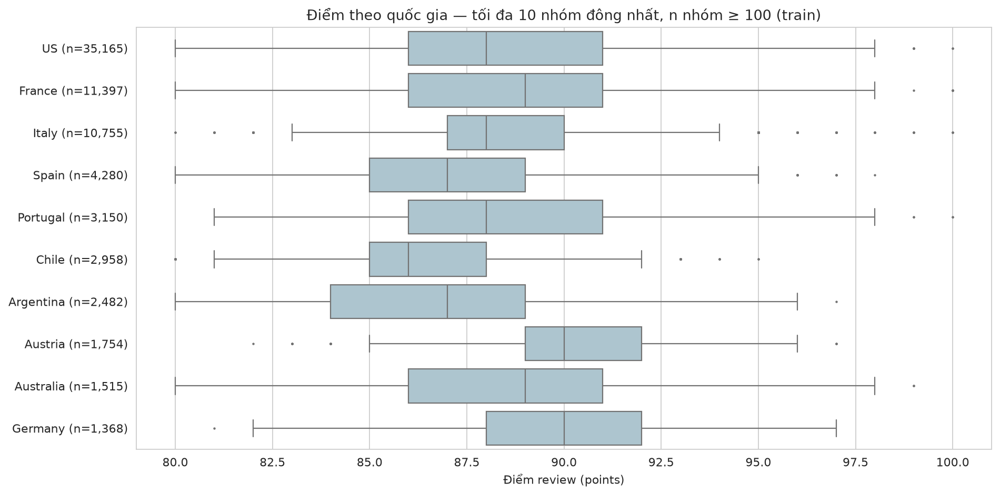

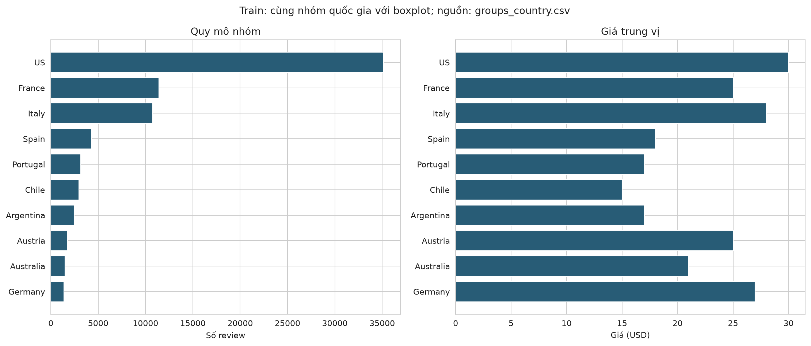

**Hàm ý:** đọc điểm cùng giá và số mẫu. **Giới hạn:** khác biệt chưa kiểm định, có thể do cơ cấu giá, giống nho, người chấm và tuyển chọn review; không xếp hạng chất lượng.

## Nhóm province: quy mô, giá và điểm khác nhau ra sao?

**Cách đọc:** hai hình dùng cùng tối đa 10 nhóm đông nhất có ít nhất 100 review; boxplot cho thấy trung vị và khoảng tứ phân vị, hình bối cảnh cho quy mô và giá.

| province | rows | missing_price | price_median | points_mean | points_median | points_q25 | points_q75 |
| --- | --- | --- | --- | --- | --- | --- | --- |
| California | 23424 | 0 | 32.0 | 88.625 | 89.0 | 86.0 | 91.0 |
| Washington | 5560 | 0 | 29.0 | 88.979 | 89.0 | 87.0 | 91.0 |
| Oregon | 3418 | 0 | 30.0 | 89.06 | 89.0 | 87.0 | 91.0 |
| Tuscany | 3250 | 0 | 35.0 | 89.241 | 89.0 | 87.0 | 91.0 |
| Bordeaux | 2569 | 0 | 20.0 | 87.998 | 88.0 | 86.0 | 90.0 |
| Northern Spain | 2476 | 0 | 19.0 | 87.359 | 87.0 | 85.0 | 90.0 |
| Mendoza Province | 2136 | 0 | 17.0 | 86.769 | 87.0 | 84.0 | 89.0 |
| Burgundy | 2022 | 0 | 43.0 | 89.697 | 90.0 | 87.0 | 92.0 |
| Piedmont | 1984 | 0 | 49.0 | 89.613 | 90.0 | 87.0 | 92.0 |
| New York | 1753 | 0 | 20.0 | 87.114 | 87.0 | 86.0 | 89.0 |

**Kết quả:** nhóm đông nhất California có 23,424 review; điểm trung bình 88.62, giá trung vị 32 USD. Chênh lệch trung bình cao nhất–thấp nhất trong các nhóm hiển thị là 2.93 điểm.

**Độ chồng lấn:** hai nhóm có trung bình thấp/cao nhất là Mendoza Province và Burgundy; khoảng Q1–Q3 lần lượt [84, 89] và [87, 92]. Hai khoảng có giao nhau.

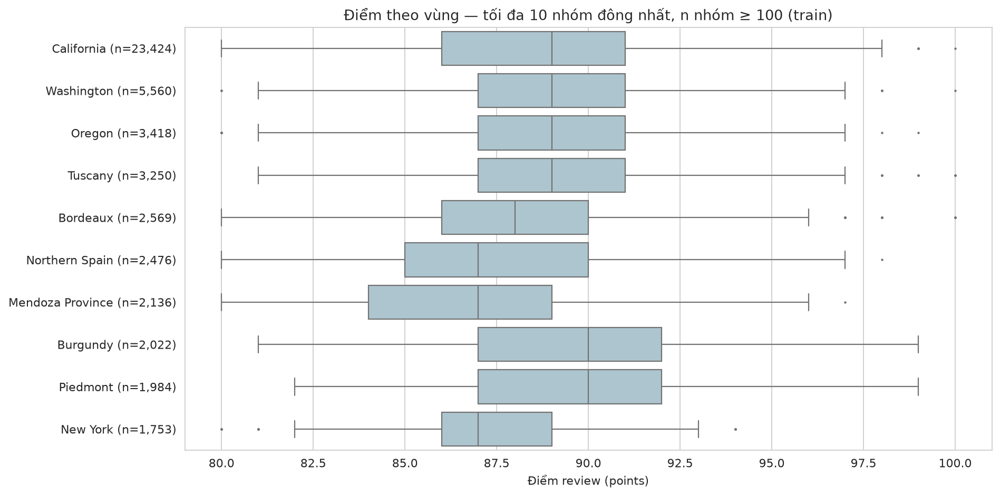

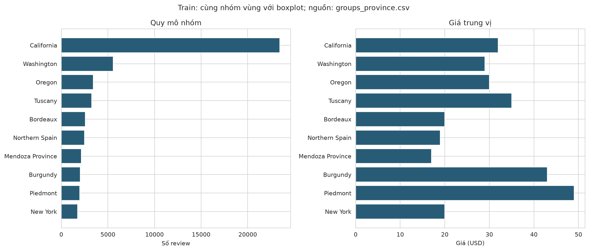

**Hàm ý:** đọc điểm cùng giá và số mẫu. **Giới hạn:** khác biệt chưa kiểm định, có thể do cơ cấu giá, giống nho, người chấm và tuyển chọn review; không xếp hạng chất lượng.

## Nhóm variety: quy mô, giá và điểm khác nhau ra sao?

**Cách đọc:** hai hình dùng cùng tối đa 10 nhóm đông nhất có ít nhất 100 review; boxplot cho thấy trung vị và khoảng tứ phân vị, hình bối cảnh cho quy mô và giá.

| variety | rows | missing_price | price_median | points_mean | points_median | points_q25 | points_q75 |
| --- | --- | --- | --- | --- | --- | --- | --- |
| Pinot Noir | 8254 | 0 | 42.0 | 89.455 | 90.0 | 87.0 | 92.0 |
| Chardonnay | 7196 | 0 | 26.0 | 88.303 | 88.0 | 86.0 | 91.0 |
| Cabernet Sauvignon | 6128 | 0 | 36.0 | 88.602 | 88.0 | 86.0 | 91.0 |
| Red Blend | 5452 | 0 | 28.0 | 88.37 | 88.0 | 87.0 | 90.0 |
| Bordeaux-style Red Blend | 3436 | 0 | 30.0 | 88.829 | 89.0 | 87.0 | 91.0 |
| Riesling | 3224 | 0 | 22.0 | 89.48 | 90.0 | 87.0 | 92.0 |
| Sauvignon Blanc | 3103 | 0 | 18.0 | 87.322 | 87.0 | 85.0 | 89.0 |
| Syrah | 2637 | 0 | 35.0 | 89.254 | 90.0 | 87.0 | 92.0 |
| Rosé | 2072 | 0 | 16.0 | 86.788 | 87.0 | 85.0 | 89.0 |
| Merlot | 2062 | 0 | 24.0 | 87.183 | 87.0 | 85.0 | 89.0 |

**Kết quả:** nhóm đông nhất Pinot Noir có 8,254 review; điểm trung bình 89.46, giá trung vị 42 USD. Chênh lệch trung bình cao nhất–thấp nhất trong các nhóm hiển thị là 2.69 điểm.

**Độ chồng lấn:** hai nhóm có trung bình thấp/cao nhất là Rosé và Riesling; khoảng Q1–Q3 lần lượt [85, 89] và [87, 92]. Hai khoảng có giao nhau.

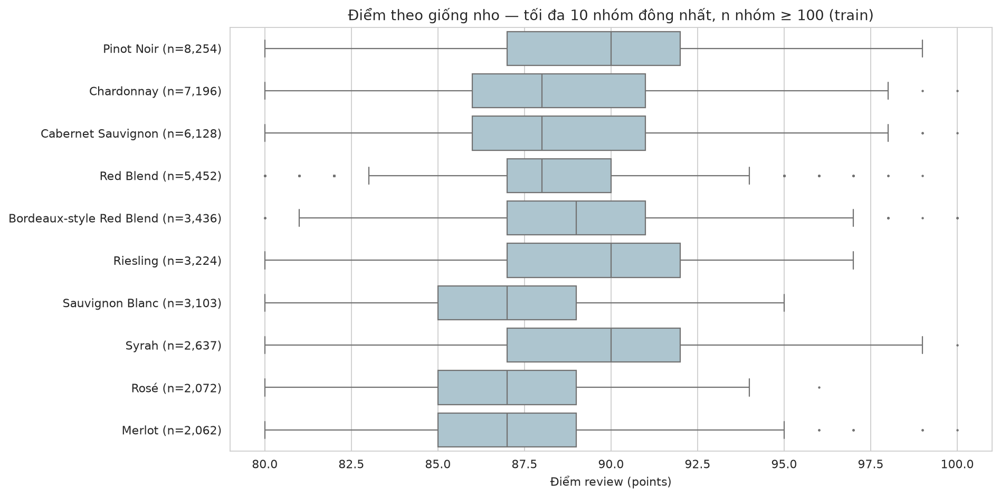

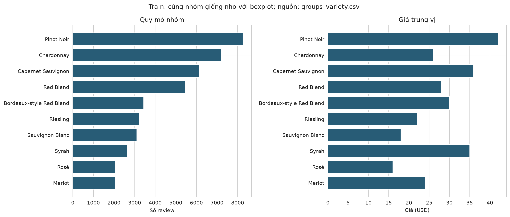

**Hàm ý:** đọc điểm cùng giá và số mẫu. **Giới hạn:** khác biệt chưa kiểm định, có thể do cơ cấu giá, giống nho, người chấm và tuyển chọn review; không xếp hạng chất lượng.

## Review có đặc điểm gì?

**Kết quả:** trung vị 40 từ; 29 review dưới 10 từ. Cờ độ dài không đồng nghĩa review vô ích.

| points_band | rows | median_words |
| --- | --- | --- |
| ≤85 | 14040 | 32.0 |
| 86–89 | 34519 | 38.0 |
| 90–94 | 28008 | 45.0 |
| ≥95 | 1539 | 56.0 |

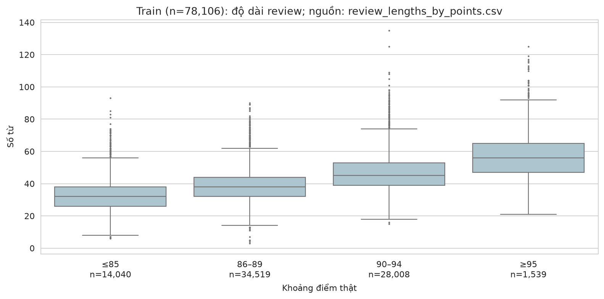

**Cách đọc:** so các phân bố cùng số mẫu. Liên hệ độ dài–điểm là mô tả, không chứng minh viết dài làm tăng điểm.

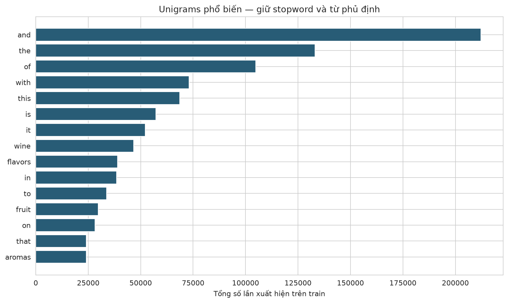

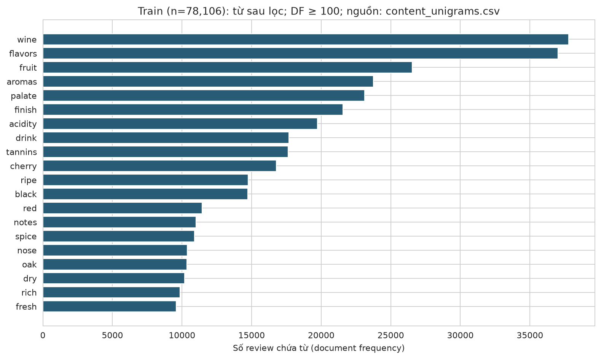

**Quy tắc bảng bổ sung:** stopword tiếng Anh scikit-learn, giữ no/not/nor/never/without; unigram có mặt trong ít nhất 100 review; top 20 theo document frequency, hòa theo từ. Bảng gốc vẫn giữ stopword/phủ định. Đây không phải sentiment, hệ số ảnh hưởng hay TF-IDF mô hình.

## Liên kết tới phân tích và dự đoán

- [Thống kê giá–điểm trên train](../analysis/REPORT.md): phân tích khám phá sau EDA.
- [Báo cáo mô hình](../model_report/REPORT.md): mô hình đã khóa, dùng dự đoán lưu sẵn.
- [Minh họa đặc trưng](../feature_examples/REPORT.md): encoder đã lưu, không fit lại.

**Giới hạn chung:** mẫu chỉ có giá quan sát; điểm thuộc người đánh giá, không phải chất lượng khách quan. Holdout từng được quan sát; audit trùng chuỗi không phát hiện near-duplicate. Mô hình đã huấn luyện và test đã đánh giá; EDA không tính metric hoặc chọn lại mô hình.

**Tái lập:** `python src/create_eda_plots.py`; bảng gốc ở tables/, checksum và phiên bản ở summary.json.
