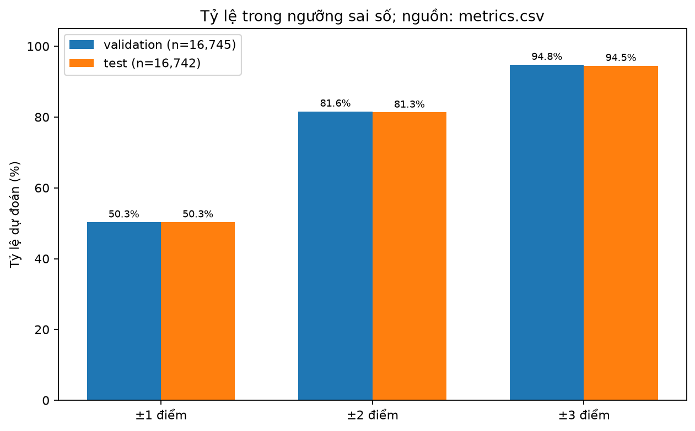
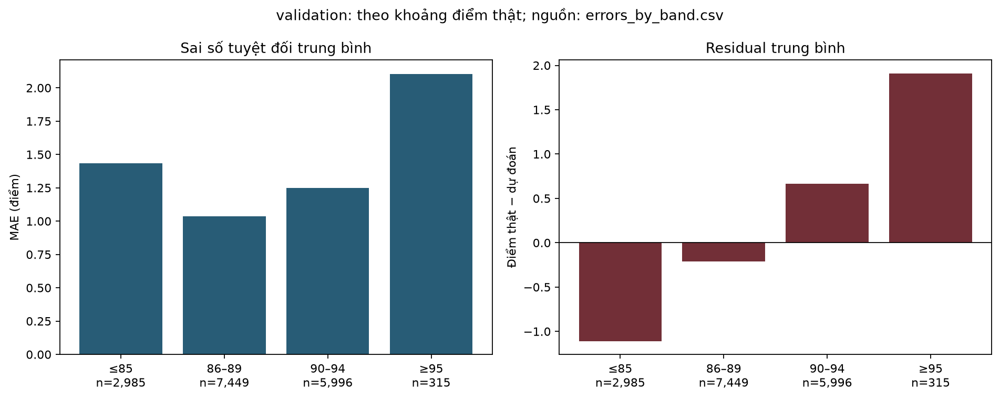
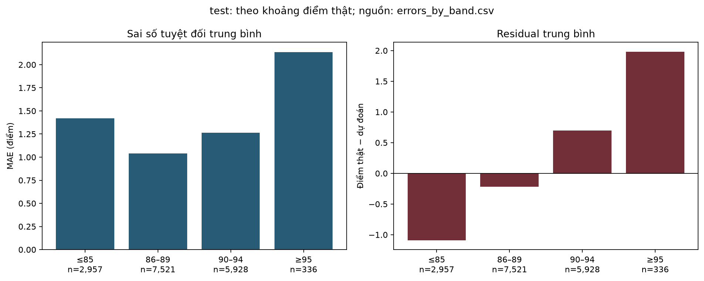

# Đánh giá bổ sung từ dự đoán đã lưu

**Câu hỏi:** mô hình sai bao nhiêu điểm, nhóm nào khó và những trường hợp nào minh họa giới hạn?

| split | n | MAE | RMSE | R2 | baseline_MAE | baseline_RMSE | baseline_R2 | MAE_reduction_pct | within_1_points_pct | within_2_points_pct | within_3_points_pct |
| --- | --- | --- | --- | --- | --- | --- | --- | --- | --- | --- | --- |
| validation | 16745 | 1.203588 | 1.532724 | 0.752696 | 2.52795 | 3.082118 | -5e-06 | 52.388748 | 50.301583 | 81.612422 | 94.798447 |
| test | 16742 | 1.208998 | 1.542601 | 0.751284 | 2.531205 | 3.09316 | -4e-06 | 52.236276 | 50.316569 | 81.31645 | 94.492892 |

**validation:** MAE 1.204 điểm, giảm 52.39% so baseline; 81.61% dự đoán trong ±2 điểm. Nhóm sai số lớn nhất ≥95: MAE 2.104, n=315, residual trung bình 1.911.

**test:** MAE 1.209 điểm, giảm 52.24% so baseline; 81.32% dự đoán trong ±2 điểm. Nhóm sai số lớn nhất ≥95: MAE 2.136, n=336, residual trung bình 1.983.

Các tỷ lệ ±1/2/3 điểm tính cả biên, là thống kê bổ sung sau đánh giá; không phải accuracy phân loại hoặc tiêu chí chọn mô hình. Không cắt/làm tròn dự đoán trước tính metric.

| split | band | n | MAE | mean_residual |
| --- | --- | --- | --- | --- |
| validation | ≤85 | 2985 | 1.433864 | -1.108588 |
| validation | 86–89 | 7449 | 1.038064 | -0.211251 |
| validation | 90–94 | 5996 | 1.247262 | 0.663785 |
| validation | ≥95 | 315 | 2.104399 | 1.910599 |
| test | ≤85 | 2957 | 1.419391 | -1.088631 |
| test | 86–89 | 7521 | 1.040557 | -0.217127 |
| test | 90–94 | 5928 | 1.2652 | 0.697544 |
| test | ≥95 | 336 | 2.136192 | 1.983015 |

Residual = điểm thật − dự đoán; số dương là dự đoán thấp. Nhóm theo điểm thật chỉ dùng đánh giá hồi cứu, chưa biết nhóm này khi dự đoán review mới. Xem số mẫu trước khi so sánh.

## Trường hợp minh họa trên validation

Chọn ba sai số nhỏ nhất và ba lớn nhất; hòa theo source_row_id tăng dần. Các trường hợp không đại diện toàn bộ dữ liệu và không chứng minh nguyên nhân sai số.

| source_row_id | points_actual | points_predicted | price | country | variety | description | absolute_error | selection |
| --- | --- | --- | --- | --- | --- | --- | --- | --- |
| 103900 | 90.0 | 90.000044 | 27.0 | Italy | Sauvignon | Elegantly structured, it starts with aromas of cut grass, stone fruit and pineapple alongside whiffs of mineral and Alpine herbs. The smooth, linear palate delivers white peach, apple, lime, exotic fruit and flinty minerality plus crisp acidity. | 4.4e-05 | smallest_error |
| 113953 | 89.0 | 89.000394 | 35.0 | US | Pinot Noir | This offers whiffs of soft leather and persistent flavors of lightly ripened fruits, strawberries and Bing cherries. It's modest in proportion but stylish, with lingering flavors nuanced with clay and limestone. | 0.000394 | smallest_error |
| 109578 | 92.0 | 91.99949 | 24.0 | France | Melon | One of a pair of wines that comes from specific soil types. This impressive wine, from granite soil, is strongly mineral while also having some great fruit. Apples, pears and green plums all make their presence felt in this wine that deserves aging. Drink from 2018. | 0.00051 | smallest_error |
| 40948 | 92.0 | 80.422196 | 19.0 | France | Bordeaux-style Red Blend | A rustic wine, with definite barnyard flavors. The fruit has some smoky extract, but the tannins and old wood tastes intrude too much. | 11.577804 | largest_error |
| 57928 | 84.0 | 91.865092 | 119.0 | Portugal | Port | Sweet, toffee aromas lead to an equally sweet wine. It has richness, a very smooth, soft texture that coats the mouth with toffee, treacle and only a hint of blackberry fruits. Dried fruits come through in the aftertaste. | 7.865092 | largest_error |
| 21619 | 80.0 | 87.240354 | 30.0 | US | White Blend | A sweet, high-fueled blend of Chardonnay, Muscat Blanc and old-vine Trebbiano from a newly approved appellation called the Sierra Pelona Valley, north of Los Angeles, this wine has peach and lemon peel hiding behind a lathering of oak. | 7.240354 | largest_error |

**Giới hạn:** holdout từng được quan sát; audit mới kiểm tra trùng văn bản chính xác, chưa kiểm tra near-duplicate. Cần review đã có; không dự đoán chất lượng khách quan. Chưa có metadata-only để đo lợi ích riêng của review. Không điều chỉnh mô hình theo kết quả này.

**Tái lập:** `python -m wine_encoding.src.report_results`. Các bảng CSV là nguồn số liệu; checksum, phiên bản và phạm vi nằm trong `summary.json`.
